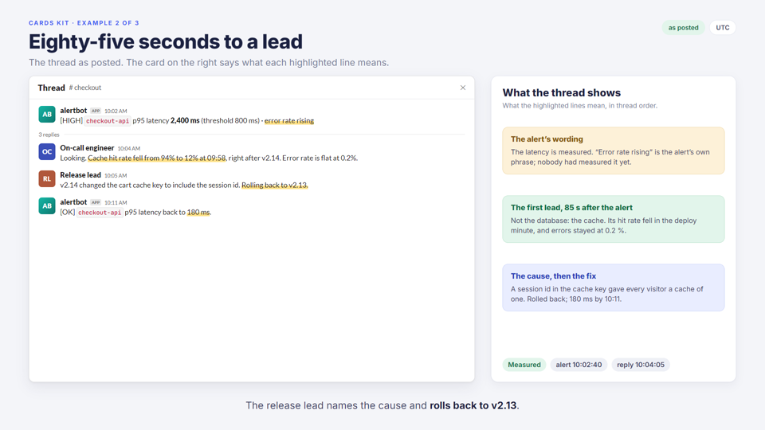
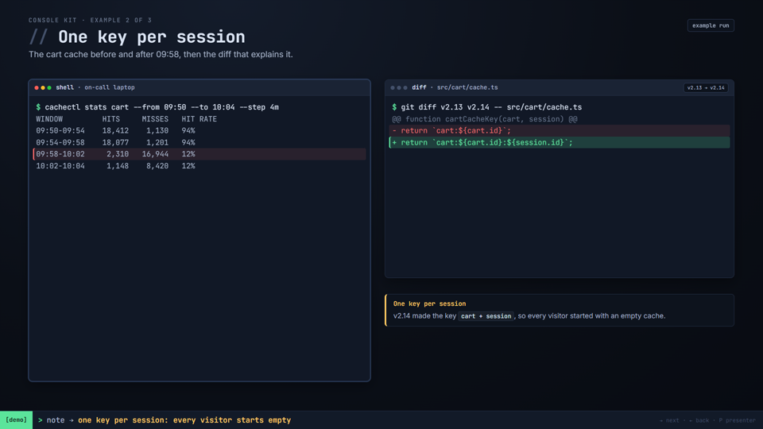
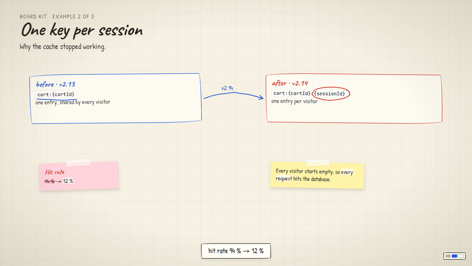
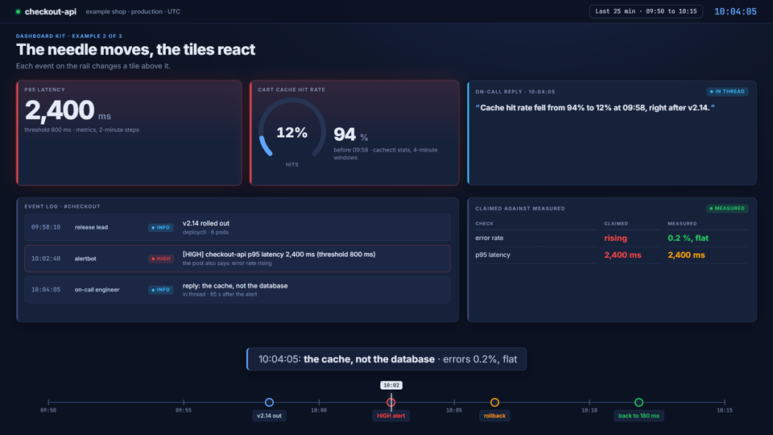

# animated-demo-deck

A Claude Code skill, and four deck kits, for animated demo talks. You give it a source: a chat thread, a run, an
incident, a package. It builds a deck in one of four kinds, each with its own look, motion and **material** (what goes on
screen, how the captions read, how the words sound). One source gives you:

- a **live HTML deck**: click-paced, with a presenter view (words, cue, target time, a clock), auto mode and fullscreen;
- **1920x1080 GIFs that play once**, one per slide, with each pause sized to its spoken lines, for Google Slides;
- a spoken **`SCRIPT.md`** with a run of show, a target time for every beat, Q&A prep and a checklist;
- a **reader-paced widget** in the same look for a blog or docs page (Next / Back, `?step=N`, system fonts, no network).

Every frame is a pure function of time, so the deck, the GIFs and the snapshots draw exactly the same thing, and the words
reach the deck from `SCRIPT.md` only through a sync script, so the presenter view, the GIF pauses and the script never
disagree.

## The four kinds

Each kit's example is the same made-up story (a release slows a checkout service, an alert fires, a thread finds a
cache-key change, a rollback ends it), so you can see how each kind shows the same facts.

| Kind | Looks like | Material | Pick it for |
|---|---|---|---|
| **cards** | light slides, cards and callouts, chat mock-ups | cards that each make one claim; messages as posted | a chat-thread replay, a product walkthrough |
| **console** | one terminal session, tmux panes, a status line | the commands that ran and their output | anything that is a run: a job, a script, SQL |
| **board** | one whiteboard; the camera flies between regions | boxes, arrows and notes; evidence taped on | architecture, decisions, a story told around evidence |
| **dashboard** | one ops screen; tiles react as a timeline needle moves | numbers, events and states | an incident timeline, a fleet, before/after numbers |

The middle slide of each kit, at its last beat:

| Cards | Console |
|---|---|
|  |  |
| **Board** | **Dashboard** |
|  |  |

Captions follow the kind's grammar: Cards "<b>The on-call engineer replies at 10:04</b>, 85 seconds after the alert.",
Console `cachectl stats cart → hit rate 94% → 12% from 09:58`, Board "the session id makes every key unique", Dashboard
`10:04:05: the cache, not the database · errors 0.2%, flat`. [`materials.md`](skills/animated-demo-deck/materials.md)
has the full rules for each kind.

## Install

```bash
git clone https://github.com/Bugzbaggy/animated-demo-deck.git
cp -r animated-demo-deck/skills/animated-demo-deck ~/.claude/skills/
```

The kits travel inside the skill folder (`kits/`). Then ask Claude Code for an animated demo, or a deck in one of the
four looks, and the skill takes it from there: it picks the kind (never the same one twice in a row for the same
audience), fills the kit's prep sheet from your source, builds the slides, writes the words and runs the checks.

**Requirements:** Node 24 or later (no npm packages), Chrome, Edge or Chromium (set `CHROME=<path>` if it is somewhere
unusual), and ffmpeg for the GIFs. Fonts are not in the repository: `node tools/fetch-fonts.mjs` in a copied kit embeds
them from Google Fonts (SIL OFL); without it the deck uses system fonts.

## Try a kit

Open `skills/animated-demo-deck/kits/cards/deck/cards-kit.html` in Chrome and press →. **P** opens the presenter view,
**A** auto-advances at GIF timing, **H** lists the keys.

## Build a deck by hand

```bash
cp -r ~/.claude/skills/animated-demo-deck/kits/console talks/my-topic/presentation
cd talks/my-topic/presentation
node tools/fetch-fonts.mjs                     # once: embed the fonts
# rename deck/console-kit.html, fill run-sheet.md, replace the example scenes in deck/scenes.js
node tools/new-script.mjs --title "My talk" --audience "the platform team"
node tools/render-gifs.mjs --timing && node tools/build-script.mjs --force
# write the words in SCRIPT.md, then:
node tools/sync-script.mjs
node tools/render-gifs.mjs --snap snaps        # a PNG at the end of every beat
node tools/render-gifs.mjs --workers 2         # the GIFs, in gifs/
S=~/.claude/skills/animated-demo-deck/scripts
node $S/check-gifs.mjs .                       # every pause matches, each GIF plays once
node $S/sweep-presenter.mjs deck/<page>.html SCRIPT.md
```

A widget for a blog or docs page starts from the kit's `widget-<kind>.html`;
`node $S/check-widget.mjs widget-console.html --widths 740,980,390` prints the iframe height for each width and fails on
horizontal overflow.

## What's inside

```
skills/animated-demo-deck/
  SKILL.md          the procedure Claude follows, the review list, common mistakes
  materials.md      each kind's material, caption grammar and voice; one fact shown four ways
  authoring.md      the engine API and each kind's helpers and verbs
  scripts/          captions, check-gifs, check-widget, measure, sweep-presenter
  kits/<kind>/      deck/ (page, engine, scenes, script), tools/, prep sheet, widget, SCRIPT.md, README.md
ci/check-kits.sh    every check, on every kit (CI runs it with --gifs)
```

## Checks

`bash ci/check-kits.sh` checks each kit the way a deck is checked: the generated script and timing are current, every
caption fits its kind's limit, the kind's material rules hold, the presenter view matches `SCRIPT.md` beat for beat, and
the widget fits at 740, 980 and 390 px. `--gifs` also renders every GIF and checks its pauses. CI runs that on Linux for
all four kits, and a leak scan on every push.

## License

MIT. See [LICENSE](LICENSE). The fonts the decks embed at setup are under the SIL Open Font License; see [AUTHORS.md](AUTHORS.md).
